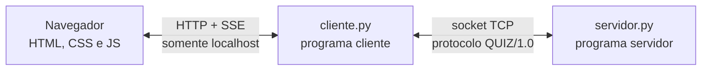
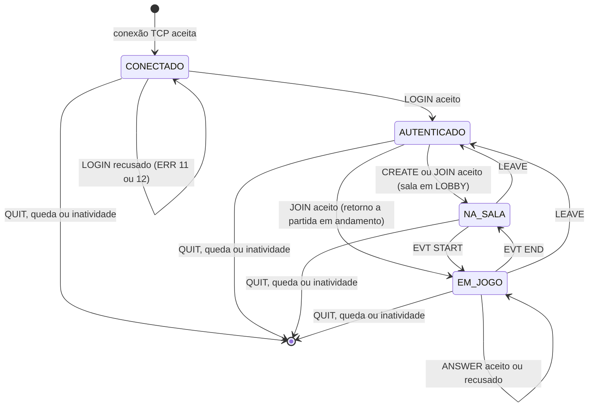
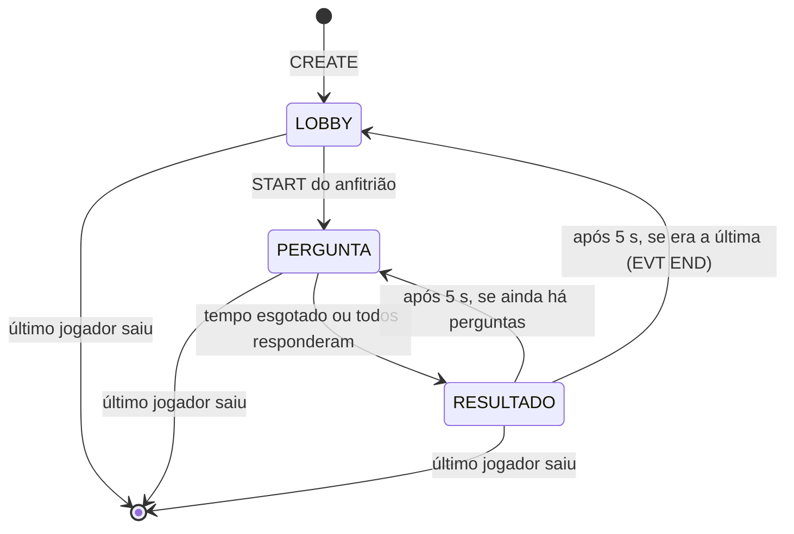
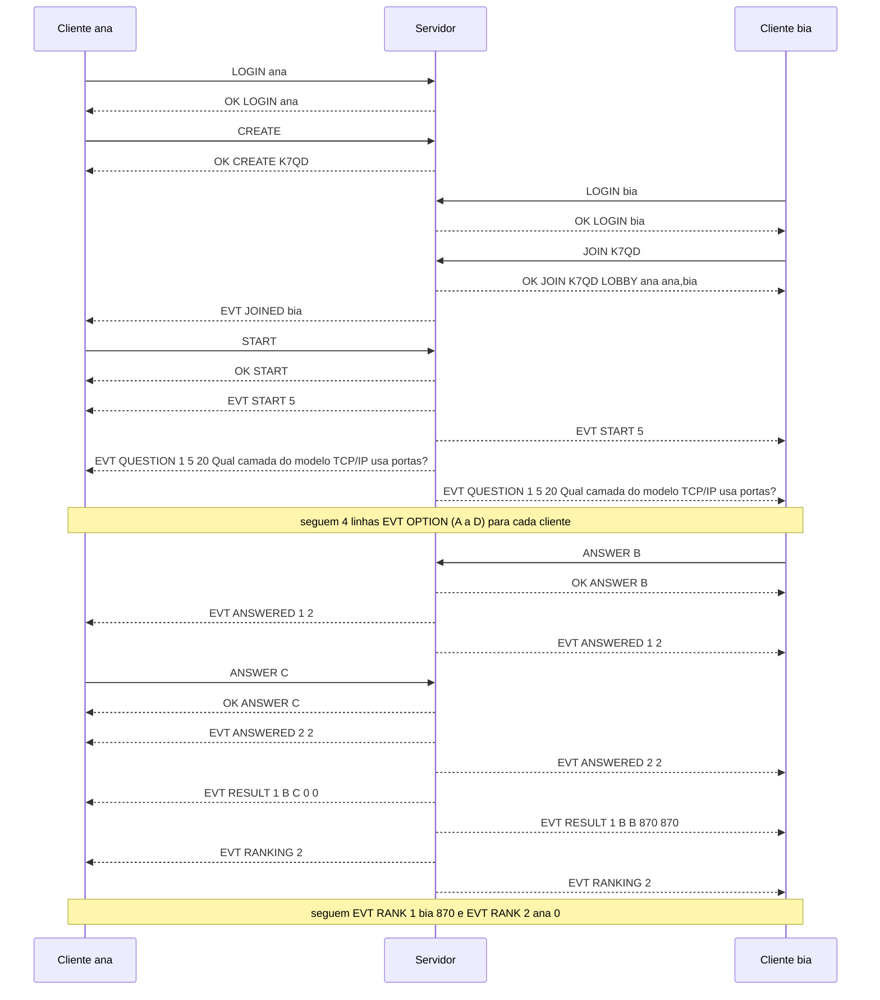

# Quiz TCP — quiz multiplayer em tempo real cliente-servidor

> Trabalho da disciplina Redes de Computadores 1 — UESC
> Equipe: _[preencher nomes]_
> Linguagem: Python 3 (somente biblioteca padrão) e interface web em HTML, CSS e JavaScript puros

## Sumário

1. [Propósito da aplicação](#1-propósito-da-aplicação)
2. [Funcionamento da aplicação](#2-funcionamento-da-aplicação)
3. [Arquitetura e papel do frontend](#3-arquitetura-e-papel-do-frontend)
4. [Por que TCP](#4-por-que-tcp)
5. [Requisitos mínimos](#5-requisitos-mínimos)
6. [Como rodar](#6-como-rodar)
7. [Protocolo de aplicação QUIZ/1.0](#7-protocolo-de-aplicação-quiz10)
8. [Códigos de erro](#8-códigos-de-erro)
9. [Falhas e queda de cliente](#9-falhas-e-queda-de-cliente)
10. [Interface local entre navegador e cliente](#10-interface-local-entre-navegador-e-cliente)
11. [Estrutura do repositório](#11-estrutura-do-repositório)
12. [Testes](#12-testes)
13. [Limitações conhecidas](#13-limitações-conhecidas)

---

## 1. Propósito da aplicação

O Quiz TCP é um jogo de perguntas e respostas para várias pessoas ao mesmo tempo, no estilo Kahoot. Um servidor central guarda as salas, envia as perguntas, cronometra as respostas, calcula a pontuação e publica o ranking a cada rodada. Cada jogador usa um programa cliente, com interface no navegador, para criar ou entrar em uma sala e responder contra o relógio.

A aplicação foi escolhida porque exige o que um protocolo de aplicação precisa especificar bem: estados do cliente e da sala, requisições e respostas, eventos iniciados pelo servidor, regras de tempo e tratamento de falhas no meio de uma partida.

## 2. Funcionamento da aplicação

- Um jogador cria uma sala e recebe um código de 4 caracteres. Ele é o anfitrião (host) da sala.
- Os outros jogadores entram na sala informando o código. Cada sala aceita de 2 a 10 jogadores.
- O anfitrião inicia a partida. O servidor sorteia 5 perguntas do arquivo `perguntas.json`.
- Cada pergunta tem 4 opções (A, B, C, D) e 20 segundos de prazo. Cada jogador pode responder uma única vez.
- A pergunta fecha quando o tempo acaba ou quando todos os jogadores conectados já responderam.
- Ao fechar, cada jogador recebe o seu resultado (opção correta, pontos ganhos, total) e todos recebem o ranking. Depois de 5 segundos, vem a próxima pergunta.
- Após a última pergunta, o servidor anuncia o vencedor e a sala volta ao lobby, pronta para outra partida.

### Pontuação

| Situação | Pontos |
|---|---|
| Resposta correta | `500 + (500 × tempo_restante_ms) // tempo_total_ms` |
| Resposta errada ou sem resposta | 0 |

Uma resposta correta vale entre 500 e 1000 pontos: quanto mais rápida, mais pontos. O tempo é medido pelo servidor, no instante em que a mensagem `ANSWER` é processada. Em caso de empate no ranking, vale a ordem alfabética do nome (sem diferenciar maiúsculas de minúsculas).

## 3. Arquitetura e papel do frontend



O enunciado exige que cliente e servidor se comuniquem por um socket TCP ou UDP com um protocolo de aplicação próprio. Um navegador não consegue abrir um socket TCP puro: ele só fala HTTP e WebSocket, que já são protocolos de aplicação prontos. Por isso a comunicação é dividida em dois trechos:

| Trecho | Tecnologia | Papel |
|---|---|---|
| Cliente ⇄ servidor | Socket TCP com o protocolo QUIZ/1.0 | É a comunicação cliente-servidor do trabalho. Todo o jogo passa por aqui |
| Navegador ⇄ cliente | HTTP e Server-Sent Events, apenas em `127.0.0.1` | É somente a camada de apresentação. O navegador funciona como a tela do programa cliente, na mesma máquina |

O `cliente.py` mantém a conexão TCP com o servidor e, ao mesmo tempo, serve a página web localmente. Cada comando do jogador na página vira uma linha do protocolo QUIZ/1.0 enviada pelo socket; cada linha recebida do servidor é repassada à página. Nenhuma regra do jogo fica no navegador. O `servidor.py` não fala HTTP nem WebSocket: ele só conhece o protocolo QUIZ/1.0.

O cliente também tem um modo terminal (`--terminal`), sem navegador, que usa exatamente a mesma conexão e o mesmo protocolo.

### Módulos

| Arquivo | Papel |
|---|---|
| `servidor.py` | Aceita conexões TCP, cria uma thread por cliente, controla o tempo das rodadas e envia os eventos |
| `quiz.py` | Regras do jogo (salas, rodadas, pontuação, ranking), sem nenhum código de rede |
| `protocolo.py` | Constantes, códigos de erro, montagem e leitura das mensagens. Usado pelo servidor e pelo cliente |
| `cliente.py` | Conexão TCP com o servidor, modo terminal e inicialização da interface web |
| `ponte_web.py` | Servidor HTTP local que liga o navegador à conexão TCP do cliente |
| `web/` | Página do jogo: `index.html`, `app.js`, `estilo.css` |

O servidor protege o estado compartilhado com um lock: cada linha recebida é processada por inteiro, inclusive o envio dos eventos que ela gera, antes de a próxima começar. Assim as respostas de uma mesma sala são processadas uma de cada vez, na ordem em que chegam, e as linhas enviadas a cada cliente nunca se intercalam (por exemplo, nada entra entre `EVT QUESTION` e as 4 linhas `EVT OPTION`).

## 4. Por que TCP

| Necessidade da aplicação | O que o TCP oferece | O que aconteceria com UDP |
|---|---|---|
| Nenhuma resposta pode se perder | Entrega confiável com retransmissão | Uma resposta perdida tiraria pontos de quem acertou; seria preciso reimplementar confirmação e retransmissão |
| Pergunta, opções, resultado e ranking precisam chegar em ordem | Entrega ordenada | O resultado poderia chegar antes da pergunta, ou as opções fora de ordem |
| O servidor precisa saber quem está na sala | Conexão com detecção de encerramento | Seria preciso criar um controle de sessão próprio |
| O volume de dados é baixo | A sobrecarga do TCP é irrelevante aqui | O ganho de velocidade do UDP não traria benefício |

O custo aceito é uma latência um pouco maior. Como a pontuação depende do tempo de resposta, isso foi considerado: a diferença é de milissegundos em uma janela de 20 segundos, e perder uma resposta seria muito pior do que atrasá-la.

## 5. Requisitos mínimos

- Python 3.10 ou superior
- Nenhuma dependência externa em Python (apenas biblioteca padrão)
- Navegador atual (Chrome, Firefox, Edge ou Safari), com suporte a `EventSource` e `fetch`
- A interface web não usa bibliotecas, CDN nem etapa de build, e funciona sem internet
- Windows, Linux ou macOS
- Rede com conectividade TCP entre cliente e servidor (porta padrão 5000 liberada)

## 6. Como rodar

### 6.1 Pré-requisitos

Confira a versão do Python (precisa ser 3.10 ou superior):

```bash
python --version
```

No Linux e no macOS o comando costuma ser `python3`; no Windows também funciona `py`. Use o mesmo comando no lugar de `python` nos exemplos abaixo. Não há nada para instalar com `pip`.

```bash
git clone [link do repositório]
cd quiz-tcp
```

### 6.2 Iniciar o servidor

```bash
python servidor.py --host 0.0.0.0 --porta 5000
```

O terminal do servidor mostra, com horário e endereço do cliente, cada linha recebida (`<<`) e enviada (`>>`). `Ctrl+C` desliga o servidor e avisa todos os clientes com `EVT SHUTDOWN`.

### 6.3 Iniciar os clientes

Abra um terminal para cada jogador:

```bash
python cliente.py --host 127.0.0.1 --porta 5000
```

Cada `cliente.py` abre o navegador automaticamente em `http://127.0.0.1:8000`. Na página: digite o nome, crie uma sala (ou entre com o código de uma sala existente) e, se for o anfitrião, clique em "Iniciar partida" quando houver pelo menos 2 jogadores.

**Vários clientes na mesma máquina:** basta abrir outros terminais e repetir o comando. Se a porta web 8000 estiver ocupada, o cliente tenta as 19 portas seguintes (8001, 8002, ...) e mostra no terminal o endereço que ficou valendo. Cada jogador usa a aba do seu próprio cliente. Para escolher a porta: `python cliente.py --porta-web 8001`.

`Ctrl+C` no terminal do cliente fecha o programa. Para o servidor isso é uma queda de conexão (`EVT LEFT <usuario> disconnect`). O botão "Encerrar sessão" da página (ou o comando `encerrar` do modo terminal) envia `QUIT` antes de fechar.

### 6.4 Jogar em máquinas diferentes na mesma rede

1. Na máquina do servidor, descubra o endereço IP na rede local:
   - Windows: `ipconfig` (linha "Endereço IPv4")
   - Linux: `ip addr` ou `hostname -I`
   - macOS: `ipconfig getifaddr en0`
2. Libere a porta TCP 5000 no firewall da máquina do servidor:
   - Windows (terminal como administrador): `netsh advfirewall firewall add rule name="Quiz TCP" dir=in action=allow protocol=TCP localport=5000`
   - Linux com ufw: `sudo ufw allow 5000/tcp`
   - macOS: aceite o aviso "permitir conexões de entrada" que aparece ao iniciar o servidor
3. Inicie o servidor com `--host 0.0.0.0` (o padrão), para aceitar conexões de outras máquinas.
4. Em cada máquina de jogador, rode o cliente apontando para o IP do servidor:

```bash
python cliente.py --host 192.168.0.10 --porta 5000
```

Cada jogador precisa do repositório na própria máquina, porque o navegador conversa com o `cliente.py` local, e não com o servidor.

### 6.5 Modo terminal

```bash
python cliente.py --host 127.0.0.1 --porta 5000 --terminal
```

O programa pede o nome e depois aceita os comandos abaixo, traduzidos para o protocolo:

| Comando | Linha enviada |
|---|---|
| `criar` | `CREATE` |
| `entrar <codigo>` | `JOIN <codigo>` |
| `iniciar` | `START` |
| `responder <letra>` ou só a letra | `ANSWER <letra>` |
| `sair` | `LEAVE` |
| `encerrar` | `QUIT` |
| `bruto <linha>` | a linha exatamente como digitada (para testar o protocolo) |
| `ajuda` | mostra a lista de comandos |

Com `--debug`, o cliente mostra também as linhas brutas: `>>` para as enviadas e `<<` para as recebidas.

### 6.6 Testar o protocolo com nc ou telnet

Como o protocolo é texto puro, dá para conversar com o servidor sem o cliente:

```bash
nc 127.0.0.1 5000
```

ou `telnet 127.0.0.1 5000`. Depois é só digitar as linhas do protocolo, em maiúsculas (`LOGIN ana`, `CREATE`, `PING`, ...). O servidor aceita linhas terminadas em `\n` ou em `\r\n`. Sem enviar nada por 60 segundos, a conexão é encerrada com `ERR 90`; digite `PING` de vez em quando para mantê-la.

No Windows, o `nc` vem com o Nmap (comando `ncat`), e o cliente telnet pode ser ativado em "Ativar ou desativar recursos do Windows". Sem nenhum dos dois, use `python cliente.py --terminal --debug` e o comando `bruto <linha>`.

### 6.7 Rodar os testes

```bash
python -m unittest discover -s tests -v
```

São 100 testes, que terminam em cerca de 5 segundos e não dependem de nada externo (ver [seção 12](#12-testes)).

### 6.8 Opções

| Programa | Opção | Padrão | Significado |
|---|---|---|---|
| `servidor.py` | `--host` | `0.0.0.0` | Endereço em que o servidor escuta |
| `servidor.py` | `--porta` | `5000` | Porta TCP do servidor |
| `servidor.py` | `--tempo` | `20` | Segundos por pergunta (inteiro, mínimo 1) |
| `servidor.py` | `--rodadas` | `5` | Perguntas por partida (no máximo a quantidade de perguntas do arquivo) |
| `servidor.py` | `--perguntas` | `perguntas.json` | Arquivo de perguntas |
| `cliente.py` | `--host`, `--porta` | `127.0.0.1`, `5000` | Endereço do servidor |
| `cliente.py` | `--porta-web` | `8000` | Porta local da interface web |
| `cliente.py` | `--terminal` | desligado | Joga pelo terminal, sem navegador |
| `cliente.py` | `--debug` | desligado | Mostra no terminal as linhas brutas do protocolo |

A página do jogo tem um painel "Protocolo", recolhível, que mostra as linhas brutas enviadas e recebidas pelo socket TCP, com direção e horário.

### 6.9 Problemas comuns

| Problema | Causa provável | Solução |
|---|---|---|
| `Erro ao abrir a porta 5000` ao iniciar o servidor | Outro servidor (ou outro programa) já usa a porta | Feche o outro processo ou use outra porta: `python servidor.py --porta 5001` (e a mesma `--porta` nos clientes) |
| `Não foi possível conectar` no cliente (conexão recusada) | Servidor desligado, ou `--host`/`--porta` errados | Inicie o servidor primeiro e confira o endereço e a porta |
| O cliente trava e depois falha ao conectar em outra máquina | Firewall bloqueando a porta, ou máquinas em redes diferentes | Libere a porta 5000 (seção 6.4) e confira se as máquinas se enxergam com `ping <ip do servidor>` |
| O navegador não abriu sozinho | Sistema sem navegador padrão configurado, ou sessão sem interface gráfica | Copie o endereço que o cliente mostra no terminal (`http://127.0.0.1:8000`) e abra manualmente |
| A página mostra "Cliente fechado" | O `cliente.py` daquela aba foi encerrado | Inicie o `cliente.py` de novo e recarregue a página |
| Dois jogadores na mesma máquina veem a mesma tela | Os dois abriram a aba do mesmo cliente | Cada jogador usa o endereço do seu próprio `cliente.py` (8000, 8001, ...) |
| Acentos aparecem trocados no terminal do Windows | Terminal antigo com outra página de código | Use o Windows Terminal, ou rode `chcp 65001` antes de iniciar o programa |
| `python` não é reconhecido | Python fora do PATH | Use `py` (Windows) ou `python3` (Linux e macOS) |

### Exemplo de sessão

_[colar aqui capturas de tela da interface. Telas a capturar: (1) lobby da sala com o código em destaque e dois jogadores; (2) pergunta aberta com a barra de tempo e o painel "Protocolo" aberto; (3) resultado da pergunta com o ranking; (4) tela final com o vencedor; (5) terminal do servidor com o log da partida]_

## 7. Protocolo de aplicação QUIZ/1.0

### 7.1 Formato geral

- Transporte: TCP, porta padrão 5000.
- Mensagens em texto UTF-8, uma por linha, terminadas em `\n`. Um `\r` antes do `\n` é aceito e descartado, para que `telnet` e terminais que enviam `\r\n` funcionem.
- Campos separados por um único espaço. O comando vem sempre em maiúsculas (`login` não é reconhecido).
- Somente o último campo de uma mensagem pode conter espaços (texto de pergunta ou de opção).
- Tamanho máximo de uma linha: 1024 bytes, sem contar o `\n`.
- Nome de usuário: 3 a 16 caracteres, apenas letras sem acento, dígitos e `_`. Maiúsculas e minúsculas são diferentes (`Ana` e `ana` são dois nomes).
- Código de sala: 4 caracteres, letras maiúsculas e dígitos.
- Como o TCP entrega um fluxo de bytes, e não mensagens, cada lado acumula os bytes recebidos em um buffer e só processa uma mensagem quando encontra `\n`.

Há três tipos de mensagem:

| Tipo | Sentido | Forma |
|---|---|---|
| Requisição | cliente → servidor | `COMANDO [argumentos]` |
| Resposta | servidor → cliente | `OK ...`, `ERR <código> <motivo>`, `PONG` ou `BYE` |
| Evento | servidor → cliente, sem requisição | `EVT <tipo> [argumentos]` |

Toda requisição recebe exatamente uma resposta. Eventos começam sempre com `EVT`, então o cliente consegue separá-los das respostas.

### 7.2 Estados do cliente



Comandos aceitos em cada estado (qualquer outro resulta em `ERR 03`):

| Comando | CONECTADO | AUTENTICADO | NA_SALA | EM_JOGO |
|---|:---:|:---:|:---:|:---:|
| `LOGIN` | sim | — | — | — |
| `CREATE` | — | sim | — | — |
| `JOIN` | — | sim | — | — |
| `START` | — | — | sim | — |
| `ANSWER` | — | — | — | sim |
| `LEAVE` | — | — | sim | sim |
| `PING` | sim | sim | sim | sim |
| `QUIT` | sim | sim | sim | sim |

O servidor valida cada linha nesta ordem: o comando existe (senão `ERR 01`); a quantidade de argumentos está correta (senão `ERR 02`); o comando é permitido no estado atual (senão `ERR 03`); por fim, as regras específicas do comando (erros 11 a 33).

### 7.3 Estados da sala



### 7.4 Requisições e respostas

| Requisição | Resposta de sucesso | Erros possíveis |
|---|---|---|
| `LOGIN <nome>` | `OK LOGIN <nome>` | 11, 12 |
| `CREATE` | `OK CREATE <codigo>` | — |
| `JOIN <codigo>` | `OK JOIN <codigo> <estado> <host> <jogadores>` | 21, 22, 23 |
| `START` | `OK START` | 24, 25 |
| `ANSWER <letra>` | `OK ANSWER <letra>` | 31, 32, 33 |
| `LEAVE` | `OK LEAVE` | — |
| `PING` | `PONG` | — |
| `QUIT` | `BYE` (o servidor fecha a conexão em seguida) | — |

Os erros gerais 01 a 04 podem ocorrer em qualquer requisição.

Campos da resposta ao `JOIN`:

- `<estado>`: `LOBBY` ou `JOGO`. `JOGO` só aparece quando um jogador retorna a uma partida em andamento (seção 9.4).
- `<host>`: nome do anfitrião atual.
- `<jogadores>`: nomes dos jogadores conectados, separados por vírgula, na ordem em que entraram, incluindo quem acabou de entrar.

`<letra>` é `A`, `B`, `C` ou `D`, em maiúscula.

### 7.5 Eventos do servidor

Enviados a todos os jogadores conectados da sala, exceto quando indicado.

| Evento | Quando ocorre |
|---|---|
| `EVT JOINED <usuario>` | Outro jogador entrou na sala (ou retornou à partida). Não é enviado a quem entrou |
| `EVT LEFT <usuario> <motivo>` | Um jogador saiu. Motivo: `leave`, `quit`, `disconnect` ou `timeout` |
| `EVT HOST <usuario>` | O anfitrião saiu e outro jogador assumiu |
| `EVT START <total>` | A partida começou, com `<total>` perguntas |
| `EVT QUESTION <n> <total> <tempo> <texto>` | Pergunta `<n>` de `<total>`, com `<tempo>` segundos de prazo |
| `EVT OPTION <letra> <texto>` | Uma opção da pergunta. São sempre 4 linhas, de A a D, logo após `EVT QUESTION` |
| `EVT ANSWERED <respondidas> <jogadores>` | Alguém respondeu. Informa só a contagem, sem revelar quem nem o quê |
| `EVT RESULT <n> <correta> <sua_resposta> <pontos> <total>` | Pergunta fechada. Enviado a cada jogador com os seus próprios dados |
| `EVT RANKING <k>` | Início do ranking, seguido de `<k>` linhas `EVT RANK` |
| `EVT RANK <posicao> <usuario> <pontos>` | Uma linha do ranking, da 1ª posição em diante |
| `EVT END <vencedor> <pontos>` | Fim da partida, enviado 5 s após o ranking da última pergunta |
| `EVT SHUTDOWN` | O servidor está sendo desligado. Enviado a todos os clientes |

Detalhes:

- Em `EVT RESULT`, `<sua_resposta>` é a letra enviada ou `-` se o jogador não respondeu; `<pontos>` são os pontos ganhos na pergunta e `<total>` é a pontuação acumulada.
- Em `EVT ANSWERED`, `<jogadores>` é a quantidade de jogadores conectados que podem responder a pergunta atual, e `<respondidas>` é quantos deles já responderam. Quem caiu, ou retornou no meio da pergunta, não entra na conta.
- O ranking traz todos os participantes da partida, inclusive os que saíram (com a pontuação congelada). `<k>` é essa quantidade.
- `EVT RESULT`, `EVT RANKING` e as linhas `EVT RANK` chegam juntos e nessa ordem para cada jogador.

### 7.6 Regras de tempo e limites

| Regra | Valor |
|---|---|
| Prazo por pergunta | 20 s (opção `--tempo`) |
| Fechamento antecipado | Quando todos os jogadores conectados da sala já responderam |
| Pausa entre resultado e próxima pergunta | 5 s |
| Perguntas por partida | 5 (opção `--rodadas`) |
| Jogadores por sala | Mínimo 2 para iniciar, máximo 10 |
| Keepalive | O cliente envia `PING` automaticamente a cada 20 s |
| Inatividade | Após 60 s sem receber nenhuma linha de um cliente, o servidor envia `ERR 90` e fecha a conexão |

### 7.7 Exemplo de troca de mensagens



## 8. Códigos de erro

Formato: `ERR <código> <motivo>`

| Código | Motivo | Quando ocorre | Depois do erro |
|---|---|---|---|
| 01 | `comando_desconhecido` | O comando não existe no protocolo (inclusive linha vazia ou comando em minúsculas) | Conexão mantida |
| 02 | `argumentos_invalidos` | Faltam argumentos, sobram argumentos (inclusive por dois espaços seguidos) ou a linha não é UTF-8 válido | Conexão mantida |
| 03 | `estado_invalido` | O comando existe, mas não é permitido no estado atual | Conexão mantida |
| 04 | `linha_muito_longa` | Mais de 1024 bytes sem `\n` | Servidor fecha a conexão |
| 11 | `nome_invalido` | Nome fora do formato permitido | Permanece em CONECTADO |
| 12 | `nome_em_uso` | Já existe um cliente conectado com esse nome | Permanece em CONECTADO |
| 21 | `sala_inexistente` | O código informado no `JOIN` não corresponde a nenhuma sala | Permanece em AUTENTICADO |
| 22 | `jogo_em_andamento` | `JOIN` em sala com partida em curso, por alguém que não fazia parte dela | Permanece em AUTENTICADO |
| 23 | `sala_cheia` | A sala já tem 10 jogadores | Permanece em AUTENTICADO |
| 24 | `nao_e_host` | `START` enviado por quem não é o anfitrião | Permanece em NA_SALA |
| 25 | `jogadores_insuficientes` | `START` com menos de 2 jogadores na sala | Permanece em NA_SALA |
| 31 | `sem_pergunta_aberta` | `ANSWER` depois que a pergunta fechou (sala em RESULTADO), depois do fim do prazo, ou de quem retornou no meio da pergunta (seção 9.4) | Permanece em EM_JOGO |
| 32 | `ja_respondeu` | Segunda resposta para a mesma pergunta | Permanece em EM_JOGO |
| 33 | `opcao_invalida` | A letra não é `A`, `B`, `C` ou `D` | Permanece em EM_JOGO |
| 90 | `inatividade` | 60 s sem nenhuma linha do cliente | Servidor fecha a conexão |

Faixas: 0x erros gerais, 1x autenticação, 2x sala, 3x resposta, 9x conexão.

## 9. Falhas e queda de cliente

### 9.1 Como o servidor detecta a queda

| Situação | Como é detectada |
|---|---|
| Cliente fechou o programa ou o terminal | A leitura do socket retorna vazio (fim de conexão) |
| Processo do cliente foi morto | `ConnectionResetError` ou `BrokenPipeError` na leitura ou na escrita |
| Cabo desconectado, rede caiu ou máquina travou | Nenhuma linha recebida em 60 s (nem `PING`): `ERR 90` e fechamento |

### 9.2 O que o servidor faz

1. Remove o cliente da lista de conectados.
2. Se o cliente estava em uma sala, envia `EVT LEFT <usuario> disconnect` (ou `timeout`) aos demais.
3. Se ele era o anfitrião, o jogador que está há mais tempo na sala assume e todos recebem `EVT HOST <usuario>`.
4. Se a sala ficou vazia, ela é apagada.
5. Libera o nome de usuário, fecha o socket e encerra a thread daquele cliente.

### 9.3 Queda no meio de uma partida

- **A partida continua para os demais.** Ninguém espera por quem caiu.
- **A pontuação de quem caiu fica congelada** e continua aparecendo no ranking até o fim da partida.
- Na pergunta em andamento, quem caiu sem responder conta como "sem resposta" (0 pontos). Uma resposta já aceita antes da queda continua valendo.
- O fechamento antecipado considera apenas os jogadores conectados: se todos os que restaram já responderam, a pergunta fecha sem esperar o prazo.
- Uma resposta que estava a caminho e não chegou completa (sem o `\n` final) é descartada.
- Uma saída voluntária com `LEAVE` ou `QUIT` durante a partida tem o mesmo tratamento.

### 9.4 Retorno à partida

Quem caiu pode voltar: basta conectar de novo, fazer `LOGIN` com o mesmo nome e `JOIN` com o código da sala.

- O servidor reconhece o nome como participante da partida e responde `OK JOIN <codigo> JOGO <host> <jogadores>`. O cliente vai direto para o estado EM_JOGO, com a pontuação preservada. Os demais recebem `EVT JOINED <usuario>`.
- A pergunta que estava em andamento no momento do retorno é perdida: um `ANSWER` para ela recebe `ERR 31`, e o jogador não é esperado no fechamento antecipado. Ele recebe o `EVT RESULT` dessa pergunta com `-` e participa normalmente a partir do próximo `EVT QUESTION`. A exceção é quem já tinha respondido antes de cair: a resposta continua valendo.
- Um anfitrião que caiu e retornou não recupera o posto: o anfitrião continua sendo quem assumiu.
- Um nome que não fazia parte da partida recebe `ERR 22` até ela terminar.

### 9.5 Outras falhas

| Falha | Comportamento |
|---|---|
| Servidor desligado com Ctrl+C | Envia `EVT SHUTDOWN` a todos e fecha as conexões |
| Servidor cai de forma abrupta | O cliente detecta o fim da conexão, avisa o jogador (na página ou no terminal) e encerra |
| Falha ao enviar um evento para um cliente | O servidor trata esse cliente como desconectado e segue o envio para os demais |
| Mensagem malformada | Resposta `ERR 01` ou `ERR 02`; a conexão é mantida |
| Jogador fecha a aba do navegador | O `cliente.py` continua conectado e mantém o keepalive; reabrir o endereço local retoma a tela |
| Jogador recarrega a página | A página recebe o histórico recente de eventos e reconstrói a tela atual |

## 10. Interface local entre navegador e cliente

Esta interface **não faz parte do protocolo QUIZ/1.0**. Ela existe só para o navegador servir de tela ao `cliente.py`, e atende apenas em `127.0.0.1`.

| Rota | Método | Função |
|---|---|---|
| `/`, `/app.js`, `/estilo.css` | GET | Arquivos da página (somente esses, da pasta `web/`; qualquer outro caminho devolve 404) |
| `/eventos` | GET | Fluxo Server-Sent Events com cada linha enviada ou recebida pelo socket TCP |
| `/comando` | POST | Recebe `{"linha": "ANSWER B"}` e envia essa linha pelo socket TCP |

Cada evento do fluxo `/eventos` é um JSON:

```json
{"direcao": "recebida", "bruta": "EVT RANK 1 bia 870", "tipo": "EVT", "nome": "RANK", "campos": ["1", "bia", "870"], "hora": 1763300000000}
```

- `direcao`: `enviada` ou `recebida`.
- `bruta`: a linha exata que passou pelo socket, usada no painel "Protocolo" da página.
- `tipo`, `nome` e `campos`: a mesma linha já interpretada pelo `protocolo.py`. `tipo` é `REQ` (linha enviada), `OK`, `ERR`, `EVT`, `PONG` ou `BYE`; `nome` é o comando, o código do erro ou o tipo do evento.
- `hora`: instante em que a linha passou pelo cliente, em milissegundos desde 1970 (igual ao `Date.now()` do JavaScript). É usado no horário do painel e na barra de tempo da pergunta.
- Se a conexão TCP cair, a ponte envia `{"tipo": "CONEXAO", "nome": "PERDIDA", "hora": ...}`.

Ao abrir o fluxo, a página recebe primeiro o histórico recente (até 1000 eventos) e depois os eventos novos, o que permite abrir ou recarregar a aba no meio do jogo. As linhas `PING` e `PONG` aparecem ao vivo no painel, mas não entram no histórico.

O `/comando` só aceita uma linha por vez, sem quebra de linha e com até 1024 bytes, com `Content-Type: application/json`. Respostas: `200 {"ok": true}` se a linha foi enviada pelo socket; `400` se o corpo é inválido; `415` se o tipo de conteúdo não é JSON; `503` se a conexão TCP com o servidor caiu.

## 11. Estrutura do repositório

```
quiz-tcp/
├── README.md              # esta documentação
├── servidor.py            # programa servidor
├── cliente.py             # programa cliente (conexão TCP, modo terminal, abre a interface web)
├── ponte_web.py           # servidor HTTP local que liga o navegador ao cliente
├── protocolo.py           # constantes, códigos de erro, montagem e leitura de mensagens
├── quiz.py                # regras do jogo (sem código de rede)
├── perguntas.json         # banco de perguntas
├── web/
│   ├── index.html
│   ├── app.js
│   └── estilo.css
├── docs/
│   └── APRESENTACAO.md    # roteiro da demonstração para o professor
├── tests/
│   ├── test_protocolo.py
│   ├── test_quiz.py
│   ├── test_integracao.py
│   └── test_ponte_web.py
└── .gitignore
```

O arquivo `perguntas.json` é uma lista de objetos com `texto`, `opcoes` (exatamente 4 textos, na ordem A a D) e `correta` (a letra `"A"` a `"D"`, ou o índice de 0 a 3). O servidor valida o arquivo ao iniciar.

## 12. Testes

```bash
python -m unittest discover -s tests -v
```

| Arquivo | O que cobre |
|---|---|
| `tests/test_protocolo.py` | Montagem de cada tipo de mensagem no formato exato; tabela de erros igual à da seção 8; interpretação de requisições, respostas e eventos, incluindo o último campo com espaços; validação de nome, código de sala e letra; leitor de linhas com mensagem partida em vários `recv`, várias mensagens em um `recv`, um byte por vez, `\r\n` e linha acima de 1024 bytes |
| `tests/test_quiz.py` | Regras do jogo sem rede, com relógio falso: pontuação pela fórmula (resposta imediata, no meio do prazo, no último instante, depois do prazo, errada e sem resposta); ranking e desempate alfabético; fechamento antecipado; prazos da pergunta e da pausa; fim da partida; troca de anfitrião; sala vazia apagada; pontuação congelada de quem saiu; retorno à partida; validação do `perguntas.json` |
| `tests/test_integracao.py` | Servidor real em uma porta livre e clientes com sockets reais: partida completa com dois clientes conferindo cada linha e a ordem delas; mensagens partidas e agrupadas no socket; fechamento pelo prazo; cada código de erro da tabela (01, 02, 03, 04, 11, 12, 21, 22, 23, 24, 25, 31, 32, 33, 90); `LEAVE`, `QUIT` e `EVT SHUTDOWN`; queda abrupta no meio da partida (os demais recebem `EVT LEFT`, a partida continua e a pontuação fica no ranking); queda do anfitrião (`EVT HOST`); retorno à partida com o mesmo nome |
| `tests/test_ponte_web.py` | Servidor, conexão do cliente e ponte HTTP em portas livres, usando `urllib`: `POST /comando` chega ao servidor pelo socket TCP; `/eventos` entrega as linhas enviadas e recebidas no formato da seção 10; uma aba nova recebe o histórico; comandos inválidos são recusados sem chegar ao socket; só os arquivos de `web/` são servidos; a queda da conexão TCP vira o evento `CONEXAO PERDIDA` |

Os testes de integração usam tempos curtos (pausa de 0,3 s) e a suíte inteira termina em cerca de 5 segundos.

## 13. Limitações conhecidas

- Não há senha: a identidade é apenas o nome de usuário, então outra pessoa pode retornar à partida com o nome de quem caiu.
- O estado fica somente em memória. Se o servidor cair, as salas e partidas em andamento são perdidas.
- A comunicação não é criptografada.
- Cada jogador precisa rodar o `cliente.py` na própria máquina; não é possível jogar só com um navegador ou celular, porque o navegador não abre sockets TCP.
- A medição do tempo de resposta é feita no servidor, então a latência da rede de cada jogador influencia um pouco a pontuação.
- As perguntas são definidas no arquivo `perguntas.json` antes de o servidor iniciar; não há comando para cadastrá-las pelo cliente.
- Se todos os jogadores de uma sala caírem ao mesmo tempo, a sala é apagada e a partida não pode ser retomada.
- O servidor usa um único lock para todo o estado e envia os eventos com o lock tomado. Isso simplifica a garantia de ordem e é suficiente para dezenas de jogadores, mas não escalaria para milhares de conexões.
